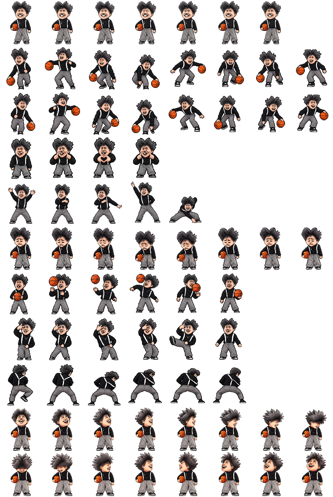
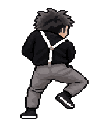

# 鸡哥 · Codex Pet

一个可迁移到 Codex 的动态宠物包。运行宠物只需要 `pet.json` 和 `spritesheet.webp`；动作 GIF 是预览，不参与运行。

## 动作预览

| 状态 | 动作 | 预览 |
| --- | --- | --- |
| `idle` | 待机眨眼 |  |
| `running-right` | 右向运球 |  |
| `running-left` | 左向运球 |  |
| `waving` | 画爱心 |  |
| `jumping` | 举手蹲跳舞 |  |
| `failed` | 伤心反应 |  |
| `waiting` | 抛篮球 |  |
| `running` | 踢腿扭胯舞 |  |
| `review` | 铁山靠 / 甩肩 |  |

左右运球共用同一动作并朝对应方向呈现。宠物图集对每个状态有固定帧数，GIF 预览展示与运行图集一致的动作帧。

## 安装

1. 下载仓库，或解压 GitHub 页面上的 **Download ZIP**。
2. 在本机 Codex 宠物目录中新建 `chicken-bro` 文件夹：
   - Windows：`%USERPROFILE%\.codex\pets\chicken-bro\`
   - macOS / Linux：`~/.codex/pets/chicken-bro/`
3. 把仓库根目录中的 `pet.json` 和 `spritesheet.webp` 复制进去。`previews/` 目录和 GIF 不需要复制。
4. 重新启动 Codex，在宠物设置中选择 **鸡哥**。

如果该目录里已有同 ID 的宠物，先备份原来的 `pet.json` 和 `spritesheet.webp`；复制后会替换对应文件。

## 使用

选择“鸡哥”后，Codex 会根据标准宠物状态自动播放对应动画。本包只映射已有状态，不增加快捷键或自定义触发命令。动作触发时机由 Codex 宿主应用控制。

## 文件

- `pet.json`：宠物 ID、显示名称和精灵图配置。
- `spritesheet.webp`：运行图集，8 列 × 11 行，含九种标准动作和 16 个朝向。
- `preview.png`：完整图集预览。
- `previews/actions/`：从当前图集导出的九种状态 GIF。

## 许可与来源

本仓库文件按根目录 `LICENSE` 中的 MIT 许可证发布。参考来源文件不随仓库分发；本项目为非官方社区宠物，与 OpenAI 或参考形象相关方无关联。

---

## English

Chicken Bro is a portable animated pet package for Codex. To install it, copy `pet.json` and `spritesheet.webp` into `~/.codex/pets/chicken-bro/` (on Windows, `%USERPROFILE%\.codex\pets\chicken-bro\`), restart Codex, and select **鸡哥** in pet settings. GIFs under `previews/actions/` are previews only. Project files are under the MIT License; reference source files are not included.
